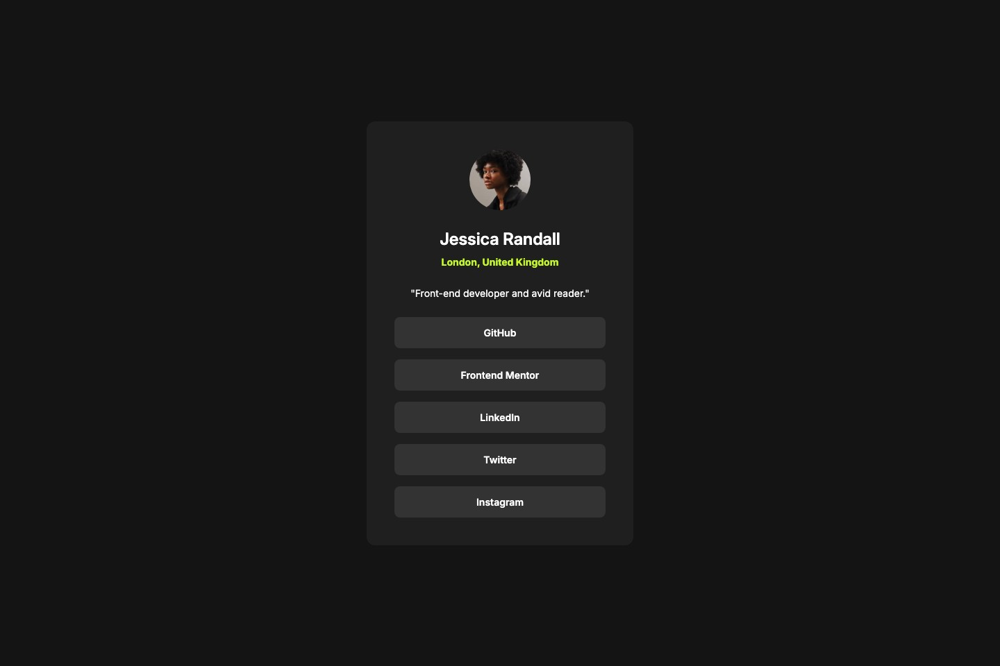

# Frontend Mentor - Social links profile solution

This is a solution to the [Social links profile challenge on Frontend Mentor](https://www.frontendmentor.io/challenges/social-links-profile-UG32l9m6dQ). Frontend Mentor challenges help you improve your coding skills by building realistic projects.

## Table of contents

- [Overview](#overview)
  - [The challenge](#the-challenge)
  - [Screenshot](#screenshot)
  - [Links](#links)
- [My process](#my-process)
  - [Built with](#built-with)
  - [What I learned](#what-i-learned)
  - [Continued development](#continued-development)
- [Author](#author)

## Overview

### The challenge

Users should be able to:

- See hover and focus states for all interactive elements on the page

### Screenshot



### Links

- Solution URL: [GitHub repository](https://github.com/skipio777/frontend-challenge/tree/main/03-social-links-profile)
- Live Site URL: [GitHub Pages](https://skipio777.github.io/frontend-challenge/03-social-links-profile/)

## My process

### Built with

- Semantic HTML5 markup
- CSS custom properties
- Flexbox

### What I learned

- **`width: 100%` and `max-width` work as a pair.** At first I only set `max-width: 384px`, but the card didn't grow to 384px. It just wrapped its content (338px). `width: 100%` makes the card fill the available space, and `max-width` stops it at 384px, so it is 384px on desktop and shrinks with the screen on mobile.

  ```css
  main {
    width: 100%;
    max-width: 384px;
  }
  ```

- **Links, not buttons.** These items take you to other sites, so they should be `<a>` links. They look the same on screen, but screen readers announce them differently ("link" vs "button"), and buttons are meant for actions on the same page.

- **`align-items: center` vs `text-align: center`.** `align-items` centers the child boxes inside a flex container, while `text-align` centers the lines of text inside a box. I noticed the difference at 320px, when the bio wrapped onto two lines and the second line stuck to the left.

- **Style the element that actually gets focus.** I first moved the button styles onto the `<li>`. It looked fine with a mouse, but an `<li>` can't receive keyboard focus, so `li:focus` never fired, and only the small text was clickable. Moving the styles back to the `<a>` fixed both the focus state and the click area.

  ```css
  a:hover,
  a:focus {
    background-color: var(--green);
    color: var(--gray-700);
  }
  ```

### Continued development

- Using semantic HTML (lists, landmarks) from the start, and testing pages with VoiceOver.
- Reading Figma files (typography presets, auto layout) and deciding what to follow when the design files disagree.

## Author

- Frontend Mentor - [@skipio777](https://www.frontendmentor.io/profile/skipio777)
