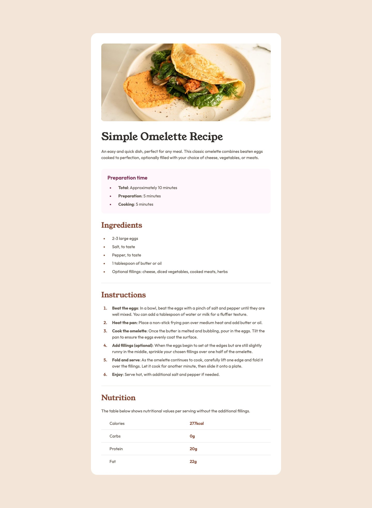

# Frontend Mentor - Recipe page solution

This is a solution to the [Recipe page challenge on Frontend Mentor](https://www.frontendmentor.io/challenges/recipe-page-KiTsR8QQKm). Frontend Mentor challenges help you improve your coding skills by building realistic projects.

## Table of contents

- [Overview](#overview)
  - [The challenge](#the-challenge)
  - [Screenshot](#screenshot)
  - [Links](#links)
- [My process](#my-process)
  - [Built with](#built-with)
  - [What I learned](#what-i-learned)
  - [Continued development](#continued-development)
- [Author](#author)

## Overview

### The challenge

Build the recipe page as close to the design as possible, and keep it responsive from 320px to large screens.

### Screenshot



### Links

- Solution URL: [GitHub repository](https://github.com/skipio777/frontend-challenge/tree/main/04-recipe-page)
- Live Site URL: [GitHub Pages](https://skipio777.github.io/frontend-challenge/04-recipe-page/)

## My process

### Built with

- Semantic HTML5 markup
- CSS custom properties
- Flexbox

### What I learned

- **`::marker` sits outside the `li` box.** I tried `margin-right` on `::marker` to move the text away from the bullet, but it had no effect. The marker hangs outside the `li` box, so I set its position with `padding-left` on `ul` and `ol`, and the distance to the text with `padding-left` on `li`.

  ```css
  ul,
  ol {
    padding-left: 26px;
  }

  li {
    padding-left: 1rem;
  }
  ```

- **Similar selectors can select very different things.** `td:first-child` selects the first cell in every row, while `tr:first-child td` selects every cell in the first row. A space means "inside", and a comma means "also apply this to". So `tr:last-child td` selects the cells in the last row, while `tr:last-child, td` selects the last row and every cell in the table.

  ```css
  tr:first-child td {
    padding-top: 0px;
  }

  tr:last-child td {
    padding-bottom: 0px;
  }
  ```

To confirm both fixes, I compared the bullet positions and table row heights with the Figma design, and measured the layout at 320px, 375px, 768px, and 1440px.

### Continued development

- Choosing the scope of `<article>` more carefully, so the whole recipe, including its title, sits inside one article.
- Learning when table cells should be `<th>` so screen readers can announce row headers.

## Author

- Frontend Mentor - [@skipio777](https://www.frontendmentor.io/profile/skipio777)
