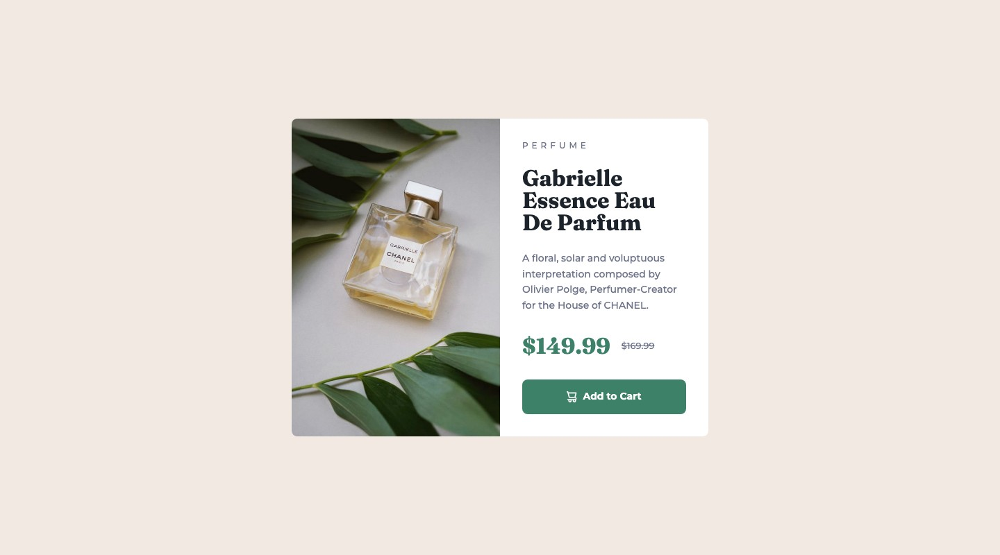
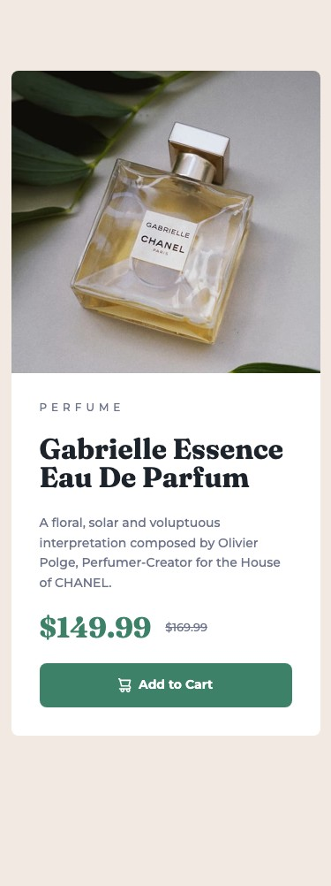
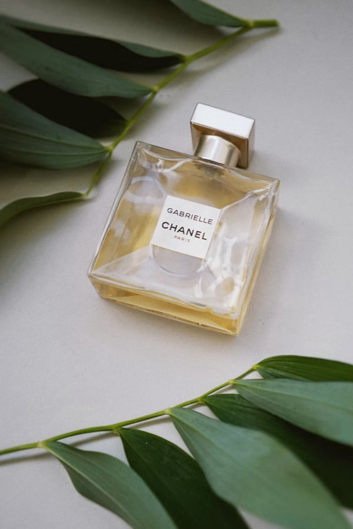

# Frontend Mentor - Product preview card component solution

This is a solution to the [Product preview card component challenge on Frontend Mentor](https://www.frontendmentor.io/challenges/product-preview-card-component-GO7UmttRfa). Frontend Mentor challenges help you improve your coding skills by building realistic projects.

## Table of contents

- [Overview](#overview)
  - [The challenge](#the-challenge)
  - [Screenshot](#screenshot)
  - [Links](#links)
- [My process](#my-process)
  - [Built with](#built-with)
  - [What I learned](#what-i-learned)
  - [Continued development](#continued-development)
- [Author](#author)

## Overview

### The challenge

Build the product preview card as close to the design as possible, with the optimal layout for each screen size and hover and focus states for the button.

### Screenshot




### Links

- Solution URL: [GitHub repository](https://github.com/skipio777/frontend-challenge/tree/main/05-product-preview-card-component)
- Live Site URL: [GitHub Pages](https://skipio777.github.io/frontend-challenge/05-product-preview-card-component/)

## My process

### Built with

- Semantic HTML5 markup
- CSS custom properties
- Flexbox

### What I learned

- **`<s>` is new to me.** It marks text that is no longer accurate, so I used it for the original price instead of a `<p>` with a CSS line-through. The line now carries meaning in the HTML, not only in the styles.

- **Choosing between `<div>` and `<section>` was not easy.** I now ask whether a group could have its own heading and make sense in a table of contents. The groups in this card exist only for layout, so I used `<div>`.

- **`<picture>` was my first time swapping images by screen size.** At first I thought I had to change the image with `@media` in CSS. Instead, `<source>` lets the HTML choose the file.

  ```html
  <picture>
    <source
      media="(max-width:624px)"
      srcset="./images/image-product-mobile.jpg"
    />
    
  </picture>
  ```

To confirm the result, I checked the button's hover, pressed, and Tab focus states by hand, and measured the layout at 320px, 375px, 624px, 625px, 768px, and 1440px.

### Continued development

- Getting more confident about when a group of elements needs `<section>` and when `<div>` is enough.
- Understanding how `height`, `min-height`, and `align-items` work together in Flexbox.

## Author

- Frontend Mentor - [@skipio777](https://www.frontendmentor.io/profile/skipio777)
