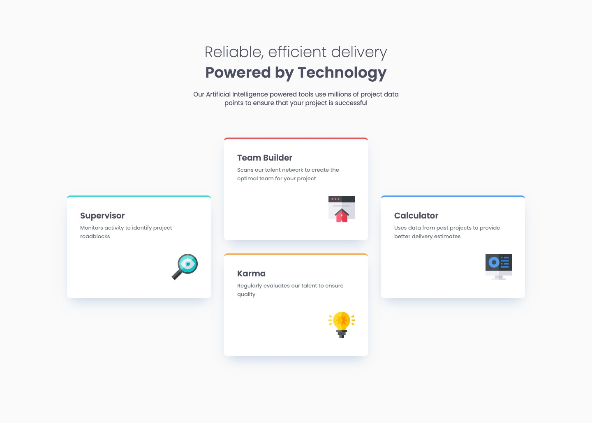

# Frontend Mentor - Four card feature section solution

This is a solution to the [Four card feature section challenge on Frontend Mentor](https://www.frontendmentor.io/challenges/four-card-feature-section-weK1eFYK). Frontend Mentor challenges help you improve your coding skills by building realistic projects.

## Table of contents

- [Overview](#overview)
  - [The challenge](#the-challenge)
  - [Screenshot](#screenshot)
  - [Links](#links)
- [My process](#my-process)
  - [Built with](#built-with)
  - [What I learned](#what-i-learned)
  - [Continued development](#continued-development)
- [Author](#author)

## Overview

### The challenge

Build the four card feature section as close to the design as possible, with the optimal layout for each screen size: three columns on desktop, two on tablet, and one on mobile.

### Screenshot




### Links

- Solution URL: [GitHub repository](https://github.com/skipio777/frontend-challenge/tree/main/06-four-card-feature-section)
- Live Site URL: [GitHub Pages](https://skipio777.github.io/frontend-challenge/06-four-card-feature-section/)

## My process

### Built with

- Semantic HTML5 markup
- CSS custom properties
- Flexbox
- CSS Grid

### What I learned

- **The hardest part was understanding CSS Grid.** It took me much longer than I expected. At first I wrapped the two middle cards in a `<div>`. On tablet, though, those two cards sit apart, and Grid only places direct children, so I removed the wrapper. On desktop I made four rows and let every card span two of them. That gave the side cards their half-card offset without any extra math.

  ```css
  .card-supervisor {
    grid-column: 1;
    grid-row: 2/4;
  }
  .card-teambuilder {
    grid-column: 2;
    grid-row: 1/3;
  }
  ```

  On tablet I used the same idea sideways: four columns, with each card spanning two, so the top and bottom cards sit in the center.

- **Two media queries can be on at the same time.** At 375px, both `max-width: 1178px` and `max-width: 724px` match, and the rule written later wins. A `height: 250px` left in the tablet query was still applied on mobile and fought with my mobile settings. Now `.card` has a single `min-height`, and the media queries only change widths.

- **`max-width` sets a ceiling, `min-height` sets a floor.** A card is at most 314px wide on mobile but shrinks on a 320px screen. It is at least 250px tall but grows when the text wraps to four lines.

- **`align-items` is for every child, `align-self` is for one.** I used `align-items: flex-end` on the card to push the icon to the right, but it moved the text block too. Moving it to `align-self: flex-end` on the icon fixed this. I checked the difference by temporarily replacing one description with a very short text.

- **Invalid values fail silently.** `grid-column: span;` without a number, or `auto` inside `padding`, made the browser ignore the whole line without any error.

- **HTML choices.** Each card has its own heading (`<h2>`) and could appear in a table of contents, so I used `<section>` for the cards. The title and intro text introduce the whole page, so I grouped them in a `<header>`. The icons are decorative, so they have empty `alt` text.

To confirm the result, I measured the layout at 320px, 375px, 724px, 725px, 1178px, 1179px, and 1440px and compared it with the design images. I also tested a card with a very short description to make sure the text still starts at the left edge.

### Continued development

- More practice with CSS Grid, so that I can plan a layout with rows and columns before I start writing code.

## Author

- Frontend Mentor - [@skipio777](https://www.frontendmentor.io/profile/skipio777)
