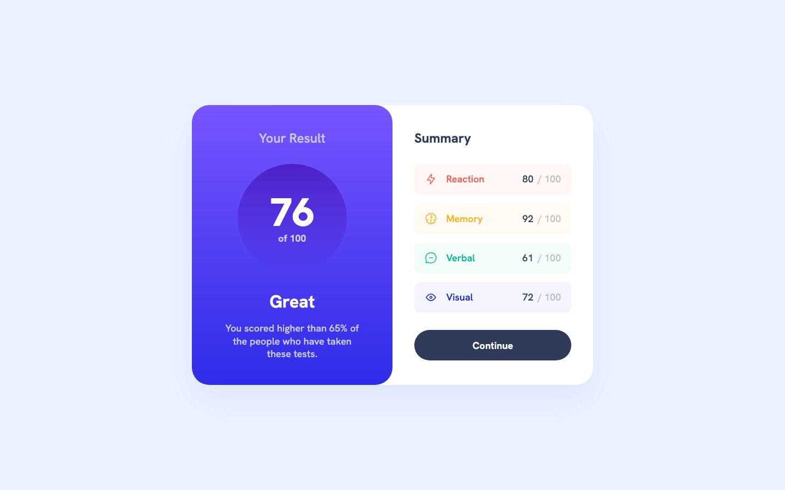
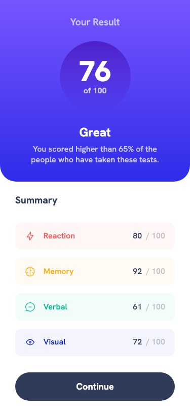

# Frontend Mentor - Results summary component solution

This is a solution to the [Results summary component challenge on Frontend Mentor](https://www.frontendmentor.io/challenges/results-summary-component-CE_K6s0maV). Frontend Mentor challenges help you improve your coding skills by building realistic projects.

## Table of contents

- [Overview](#overview)
  - [The challenge](#the-challenge)
  - [Screenshot](#screenshot)
  - [Links](#links)
- [My process](#my-process)
  - [Built with](#built-with)
  - [What I learned](#what-i-learned)
  - [Continued development](#continued-development)
- [Author](#author)

## Overview

### The challenge

Users should be able to:

- View the optimal layout for the interface depending on their device's screen size
- See hover and focus states for all interactive elements on the page

I skipped the bonus task (filling the content from the local JSON data) this time.

### Screenshot




### Links

- Solution URL: [GitHub repository](https://github.com/skipio777/frontend-challenge/tree/main/07-results-summary-component)
- Live Site URL: [GitHub Pages](https://skipio777.github.io/frontend-challenge/07-results-summary-component/)

## My process

### Built with

- Semantic HTML5 markup
- CSS custom properties
- Flexbox
- Desktop-first media queries (tablet at 800px, mobile at 750px)

### What I learned

- **The hardest part was a circle that got squashed on mobile.** I gave the result panel `max-height: 356px`, but its content was taller than that, so Flexbox squeezed the 140×140 score circle down to 140×111. First I tried `display: block` and then `flex-wrap: wrap` on the circle. Neither worked, because both properties only control how an element arranges its *own children*. The circle itself had to tell its parent "don't shrink me":

  ```css
  .result-score {
    flex-shrink: 0;
    width: 200px;
    height: 200px;
  }
  ```

  I also removed `max-height`, so now the content decides the panel's height.

- **`width: 100%` plus margin overflows, `width: auto` fits.** On a 320px screen the summary section caused a horizontal scrollbar. `width: 100%` makes the box as wide as its parent and then adds the margins outside it. `width: auto` takes the parent's width minus the margins, so the box and its margins always fit.

- **`min-height: 100vh` instead of `height: 100%`.** With the body locked to the screen height and the card centered vertically, a short window (1024×420) pushed the top 47px of the card off the screen, where it could not be reached by scrolling. With `min-height`, the body grows when the card is taller than the screen.

- **Broken code fails silently.** A comma inside a value, as in `padding: 52.6px, 59px`, made the browser ignore the whole line. Writing the `class` attribute twice on one tag made the browser drop the second one, and all four row colors disappeared. Neither mistake showed an error, so I found both by measuring the page.

- **HTML choices.** The four scores are a list of items of the same kind, so I used `<ul>` and `<li>`. The main result ("Great") is the `<h1>`, and "Summary" is an `<h2>`. The icons are decorative, so they have empty `alt` text. "Continue" is an action, so it is a `<button>`. I first colored the rows with ids, then switched to classes, because classes are the usual choice for styling and are easier to override later.

- **Hover and focus.** I used `:focus-visible` instead of `:focus` on the button. The gradient no longer stays on after a mouse click, but it still shows when the button is reached with the Tab key.

- I used the Visual score from `data.json` (72) instead of the number in the design image (73).

To confirm the result, I measured the layout at 1440px, 801px, 751px, 750px, 375px, and 320px, plus a short 1024×420 window, and checked that nothing overflowed and there was no horizontal scrollbar. I compared the screens with the design images side by side, and checked the hover state with the mouse and the focus state with the Tab key.

### Continued development

- My next step is the bonus task I skipped: reading `data.json` with JavaScript `fetch` and building the four score rows from the data, instead of writing the same row four times in the HTML.

## Author

- Frontend Mentor - [@skipio777](https://www.frontendmentor.io/profile/skipio777)
