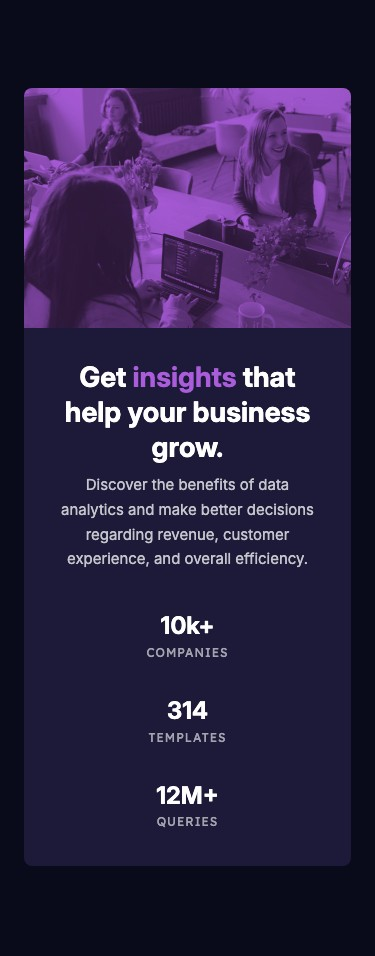

# Frontend Mentor - Stats preview card component solution

This is a solution to the [Stats preview card component challenge on Frontend Mentor](https://www.frontendmentor.io/challenges/stats-preview-card-component-8JqbgoU62). Frontend Mentor challenges help you improve your coding skills by building realistic projects.

## Table of contents

- [Overview](#overview)
  - [The challenge](#the-challenge)
  - [Screenshot](#screenshot)
  - [Links](#links)
- [My process](#my-process)
  - [Built with](#built-with)
  - [What I learned](#what-i-learned)
  - [Continued development](#continued-development)
  - [AI Collaboration](#ai-collaboration)
- [Author](#author)

## Overview

### The challenge

Users should be able to:

- View the optimal layout depending on their device's screen size

### Screenshot




### Links

- Solution URL: [GitHub repository](https://github.com/skipio777/frontend-challenge/tree/main/08-stats-preview-card-component)
- Live Site URL: [GitHub Pages](https://skipio777.github.io/frontend-challenge/08-stats-preview-card-component/)

## My process

### Built with

- Semantic HTML5 markup
- CSS custom properties
- Flexbox
- CSS Grid (two columns on desktop)
- Mobile-first media queries (tablet at 628px, desktop at 1192px)
- `<picture>` to load a different image on desktop

### What I learned

- **The hardest part was tinting a black-and-white photo purple.** The image files are grayscale, so the color had to come from CSS.
  - First I gave the photo only `opacity`. The white areas stayed almost white.
  - Then I put `mix-blend-mode: multiply` on a purple layer above the photo. It came out darker than the design. Multiply always keeps black as black, but the darkest parts of the design are dark purple, not black.
  - The fix was to put both effects on the **photo** and place the purple **underneath** it:

    ```css
    .card-banner {
      background-color: var(--purple-500); /* purple layer below */
    }
    .card-image {
      opacity: 0.75;
      mix-blend-mode: multiply;
    }
    ```

    The result is (photo × purple) × 0.75 + purple × 0.25. The 25% of purple that shows through lifts the black areas to dark purple.
  - To check it, I compared the pixel colors of the photo area with the design image. The average difference went from 25 to 38 (worse) and finally to 4.8.

- **Making the desktop photo follow the text height.** A Grid row is as tall as its tallest item. Keeping its ratio, the photo became 466px tall and pushed the row above the text column's 442px. `height: 100%` on the photo did not help, because the row height came from the photo itself. I took the photo out of the height calculation:

  ```css
  .card-banner {
    position: relative; /* the reference box */
    height: 100%;
  }
  .card-picture {
    position: absolute; /* no longer sizes the row */
  }
  ```

  Now the text column decides the row height and the photo fills it. With the browser font size at 125%, both columns grow together to 583px.

- **`min-width` media queries stack on wide screens.** The tablet rule `main { max-width: 564px; }` was still active on desktop, so the two 564px columns (1128px) overflowed a 564px box. Giving `main` a new `max-width` inside the desktop query fixed the overflow.

- **A fixed height breaks when users enlarge text.** I first gave the text column `height: 442px`. With the browser font size at 125%, the stats overflowed the card by 77px. I removed the height and let the content decide.

- **HTML choices.** The heading is an `<h1>`, and the purple word is a `<span>` with its own class instead of a `span` tag selector. The three stats are items of the same kind, so they are a `<ul>` with `<li>` items (`list-style: none` removes the bullets). The labels are written in lowercase in the HTML and shown in capitals with `text-transform: uppercase`, because some screen readers spell out all-caps words letter by letter. The photo is decorative, so it has empty `alt` text. The `media` value in `<source>` uses the same 1192px as the CSS media query.

To confirm the result, I measured the layout at 1440px, 1192px, 1191px, 768px, 628px, 627px, 375px, and 320px, plus short 1440×420 and 1024×420 windows, and checked that nothing overflowed or got cut off. After cleaning up the CSS, I compared screenshots at eight widths pixel by pixel and confirmed that nothing had changed.

### Continued development

- In the next challenge (Social proof section), I will build a layout with staggered cards. Before reaching for `position`, I will first try to place the cards with Grid line numbers only (`grid-row` and `grid-column`).
- This time I made one commit at the end. Next time I will commit after each step: structure, mobile, tablet, and desktop.

### AI Collaboration

- I used Claude Code (Claude) as a hint-based mentor, following this challenge's `AGENTS.md`. I wrote all of the HTML and CSS myself.
- I used it for step-by-step hints when I was stuck, for explanations of concepts like `multiply` and `position`, for measuring the page at many widths with headless Chrome and comparing it with the design, and for polishing the English in this README.
- What worked well: the measurements found problems I could not see by eye, such as a horizontal scrollbar at 320px and a desktop photo with a height of 0.
- What did not work: twice, values Claude measured from the design JPG (a 40px padding and a 1110px card width) were wrong, and I corrected them with the Figma file. Since then I treat Figma as the source of truth for numbers.

## Author

- Frontend Mentor - [@skipio777](https://www.frontendmentor.io/profile/skipio777)
